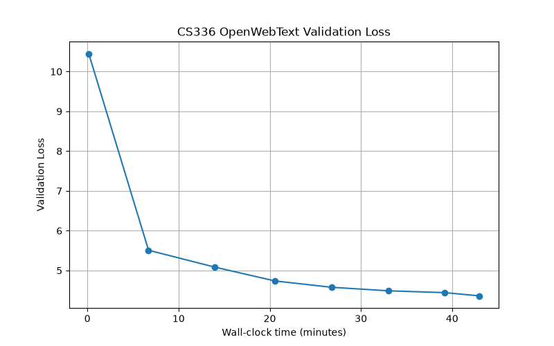

# KQYaili: 6-layer Transformer on OpenWebText

Final recorded validation loss: **4.3614** at microbatch index **6599**, with the final validation evaluation completed at the logged, rounded wall-clock time of **43.0 minutes**. Plotting and final checkpoint writing occur after this measurement; a precise total process duration was not recorded.

Hardware: **NVIDIA GeForce RTX 5070 Ti Laptop GPU (12,227 MiB)**, confirmed by the submitter. This is an unverified local result, not a B200 measurement. No cross-GPU time conversion is used.

## Method

6-layer Pre-LN Transformer (d_model=512, d_ff=1344, 16 heads, 32k BPE, context length 512), SwiGLU + RoPE, tied token embeddings and LM head. Token embeddings are initialized with trunc_normal(std=0.02, bounds=-0.06 to 0.06). AdamW (peak lr=1.2e-3, weight decay=0.01), cosine decay to 1e-5, warmup 330 microbatches, 6600 microbatches total. Microbatch size 16 with 2-step gradient accumulation (effective batch size 32), giving 3300 optimizer updates. Gradient clipping threshold: 1.0. Float32 matmul precision is set to high. The ordinary TransformerLM is used; QK Norm and Attention Residuals are not enabled for this result.

## Data and evaluation

The current preprocessing pipeline trains the 32k BPE tokenizer and tokenizes the first 128 MiB of the supplied OpenWebText training file. The resulting training token file contains 30,625,998 uint16 tokens. The supplied OpenWebText validation file is tokenized separately; each recorded validation value averages 20 randomly sampled batches of 16 sequences with length 512 (163,840 evaluated token positions), rather than a complete validation-set pass.

The exact historical provenance of reused tokenization caches has not been independently reconstructed. The reported value is the submitter's logged evaluation, not an official reproduced score.

## Evidence

- [Original training log](kqyaili_4.3614.log)
- [Logged validation points](kqyaili_4.3614.csv)
- [Learning curve](../images/kqyaili_owt_4.3614.png)

## Reproduction and eligibility

[Source snapshot](https://github.com/KQYaili/assignment1-basics-leaderboard/tree/947b6efc5cf6b1ff8c41f07cb40b902684e88ce7) is preserved on the dedicated reproduce-owt-4.3614 branch of the submitter's fork. Existing source files were uploaded byte-for-byte, with SHA256 checksums; the snapshot includes the original log and curve. A clean-environment reproduction and single-B200 run have not been performed. The snapshot has pyproject.toml and uv.lock but lacks main.py; matplotlib is not declared in the project dependency list. See the snapshot README for the existing data pipeline and remaining reproduction limitations.

AI assistance was used for conceptual discussion, code review, and preparation of these submission materials. Eligibility under the upstream README's AI rule is not asserted. Maintainer review is needed before this local result can be treated as an eligible leaderboard entry. The verification-status cell is intentionally empty.
